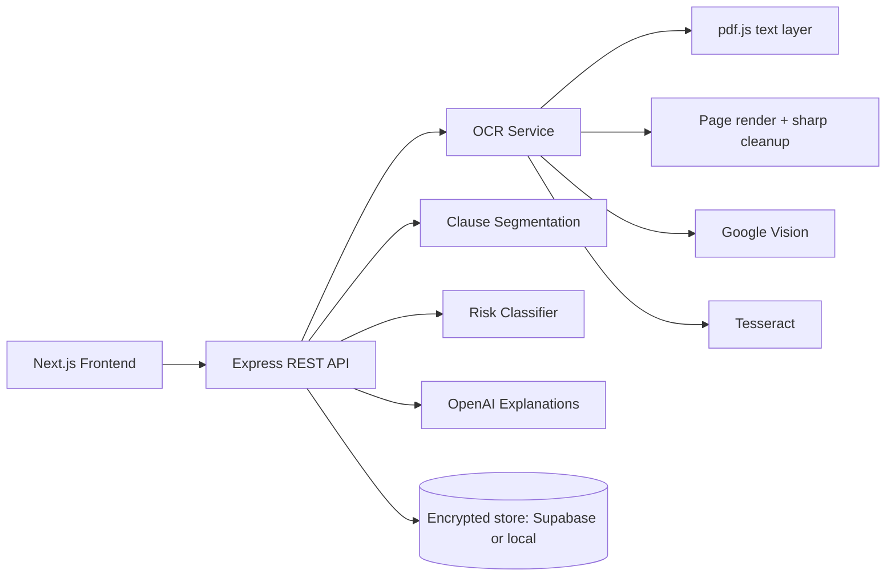

# Architecture

## System diagram

## Backend modules

- `ocr.service.ts` - reads PDFs (exact word positions), renders and OCRs scanned pages, cleans up and OCRs photos
- `documentLayout.ts` - words to lines to full text with character offsets; maps any text range back to per-line highlight rectangles
- `clauseSegmentation.service.ts` - heading- and paragraph-aware clause splitting with exact ranges
- `riskClassifier.service.ts` - predatory-term patterns plus hidden-text and AI-manipulation detection
- `aiExplanation.service.ts` - OpenAI explanations with PII masking and output whitelisting, or template fallbacks
- `analysisPipeline.service.ts` - background job queue with progress reporting
- `storage.service.ts` - AES-256-GCM encrypted persistence with owner-scoped reads
- `lib/fileType.ts`, `lib/privacy.ts`, `lib/crypto.ts`, `middleware/auth.ts` - security building blocks

## Frontend modules

- `DocumentViewer` - react-pdf / image / text rendering with per-line risk highlights, risk filters and next-risk navigation
- `ClauseExplanationPanel` — side panel with confidence & actions
- `FileDropzone` — drag-and-drop upload
- `BeforeYouSignModal` — critical warnings gate

## Extensibility

- Swap classifier for fine-tuned model via same `ClauseAnalysis` interface
- Store PDFs in Supabase Storage (`document_files` table)
- Add WebSocket for long OCR jobs
- Plug vector DB for clause similarity search
